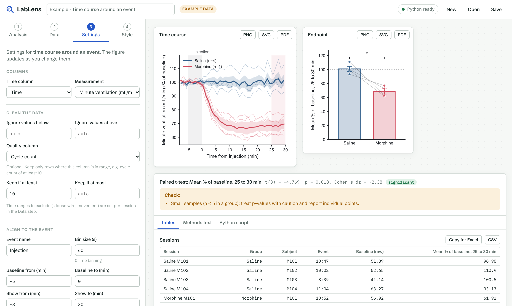

# LabLens

**Analyze lab data and make publication-quality figures without writing code.**

LabLens is a browser-based analysis tool for researchers. You paste or upload your data, choose an analysis, adjust the settings and figure style in plain menus, and get statistics, figures and a methods paragraph. Python (NumPy, SciPy, pandas, matplotlib) does the work behind the scenes, right inside the browser, so there is nothing to install and your data never leaves your computer.



## Why LabLens

- **No code.** Every analysis decision is a menu, toggle or number field. The figure updates as you change them.
- **Figures you can actually customize.** Plot types, colors, fonts, sizes, error bars and significance marks are all adjustable, with presets for journals, posters and slides.
- **Built for real lab data.** It reads tables pasted from LabChart Data Pads, Excel and Prism, including multi-row headers, clock times (`13:27`) and European decimal commas.
- **Private by design.** All computation runs locally in your browser through [Pyodide](https://pyodide.org). Nothing is uploaded to a server.
- **Reproducible.** Every analysis can be downloaded as a standalone Python script that recreates the same statistics and figures, for lab records, reviewers or further customization.

## Analyses

| Analysis | What it does |
| --- | --- |
| **Compare groups** | Descriptive statistics; automatic choice between parametric and non-parametric tests based on Shapiro-Wilk normality; Welch's / Student's / paired t-test, Mann-Whitney, Wilcoxon; one-way and repeated-measures ANOVA, Kruskal-Wallis, Friedman; Tukey, Dunnett or Holm-corrected post-hoc comparisons; effect sizes. |
| **Time course around an event** | One table per recording session, aligned to an injection or stimulus. Time binning, value and quality-column filters, per-session exclusion windows, baseline normalization (% of baseline, change, fold), group means with SEM/SD bands, and endpoint statistics (mean, nadir, peak or net AUC), paired by subject when appropriate. |
| **Correlation & regression** | Pearson or Spearman correlation, least-squares linear fit with 95% confidence band, optionally split by group. |
| **Dose-response** | Four-parameter logistic fit on log concentration, EC50/IC50 with 95% confidence intervals, Hill slope, R², optional fixed top or bottom, multiple curves or replicates. |

## Output

- Figures as **PNG** (up to 1200 dpi), **SVG** (editable text for Illustrator or Inkscape) and **PDF**
- Results tables that copy straight into Excel or Prism, or download as CSV
- An auto-generated **methods paragraph** naming the tests, corrections and software versions used
- A **Python script** that reproduces the full analysis
- Project files (`.lablens.json`) to save and reopen your work

## Getting started

LabLens is a static web app. It needs to be served over HTTP (not opened as a file) because the Python engine runs in a web worker.

**macOS:** double-click `Start LabLens.command`.

**Any system:**

```bash
git clone https://github.com/Frizzell-5/LabLens.git
cd LabLens
python3 -m http.server 8765
```

Then open <http://127.0.0.1:8765>. The first visit downloads the Python runtime and scientific libraries (about 30 MB); the browser caches them for later visits.

To try it without your own data, pick an analysis and press **Try example**.

## Deployment

There is no build step and no backend. Upload `index.html`, `app.css`, `app.js`, `worker.js` and the `engine/` folder to any static host, such as Cloudflare Pages, GitHub Pages or Netlify.

## Project structure

```
index.html          Page layout
app.css             Styles (light and dark themes)
app.js              Interface: steps, settings forms, results, exports
worker.js           Loads Pyodide and the engine off the main thread
engine/lablens.py   Analysis engine: parsing, statistics, figures, exports
docs/               Screenshots
```

The engine has a single entry point, `api(cmd, args_json)`, and also runs as ordinary Python (`cli()`), which is what the script export uses.

## Adding an analysis

1. In `engine/lablens.py`, write `analysis_<name>(datasets, settings, style)` returning figures, tables, a summary, notes and methods text, and register it in `ANALYSES`. Add sample data to `example()`.
2. In `app.js`, add an entry to `ANALYSES`, its defaults to `DEFAULT_SETTINGS`, and its form to `SETTINGS_SCHEMA`.

To test the engine outside the browser:

```bash
python3 -m venv .venv && .venv/bin/pip install numpy scipy pandas matplotlib openpyxl
.venv/bin/python -c "import sys; sys.path.insert(0, 'engine'); import lablens; print(lablens.api('example', '{\"kind\": \"compare\"}')[:200])"
```

## Roadmap

- Multi-panel figure layouts (A/B/C/D) for journal submission
- Plain-language figure editing ("make the drug group red, hide the legend")
- Survival curves, two-way ANOVA, normalization tools
- Direct import of LabChart `.adicht` files

## Status

LabLens is in early development (v0.1). Results should be checked against your own understanding of the statistics before publication; the generated methods text is a starting point, not a substitute for describing what you did.

## Author

Shadan Alrawi
